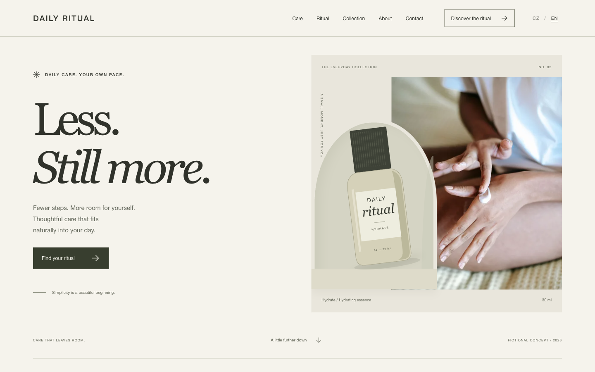
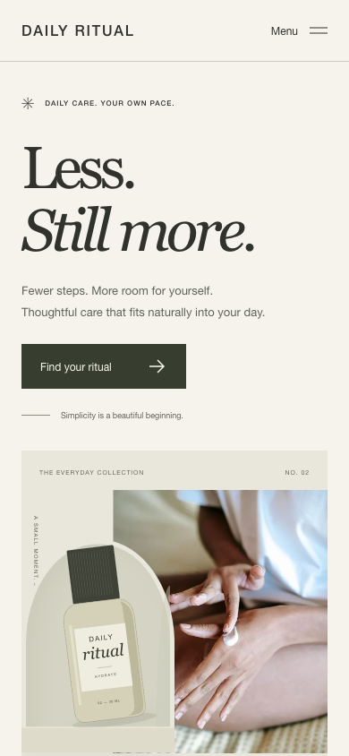

# DAILY RITUAL

A light editorial skincare concept with quiet typography, original packaging illustrations and space to breathe.

**Original portfolio concept by [VERBA](https://verbastudio.cz/).** Not commissioned client work.

[Live demo — Czech](https://dailyritual.verbastudio.cz/) · [Live demo — English](https://dailyritual.verbastudio.cz/en/) · [Source](https://github.com/Asmodaai/daily-ritual)

[](https://dailyritual.verbastudio.cz/en/)

<details>
<summary>Mobile preview and Czech views</summary>
<br>


[Czech desktop](docs/screenshots/preview-desktop-cs.png) · [Czech mobile](docs/screenshots/preview-mobile-cs.png)

</details>

## About the project

An original beauty and lifestyle concept. Warm off-white, charcoal text, serif accents and an arched composition create a calm digital setting. The collection and packaging are fictional design studies, not products for sale.

The purpose is to demonstrate visual direction and thoughtful front-end implementation across a complete, responsive website.

## Features

- Responsive editorial layout with desktop navigation and a mobile menu.
- Czech and English content, with a language switch that retains the current section.
- Morning/evening ritual selection, expandable product descriptions and native FAQ disclosures.
- Original CSS packaging illustrations paired with locally hosted, responsive WebP photography.
- A demo email form with native validation and an accessible confirmation; no subscription or transmission.
- Photography credits, keyboard focus, skip navigation and reduced-motion support.

## Technology stack

- Vue 3 and JavaScript, using single-file components and the Composition API.
- HTML and standard CSS; no UI framework.
- Vite 8 with the Vue plugin.
- A small build-time Vue server-rendering step, followed by client hydration.
- npm with a committed `package-lock.json`; Node.js 22.23.1 is pinned in `.nvmrc`.
- Static hosting on Netlify for the live demo.

## Getting started

Use Node.js 22.23.1, or a compatible version matching `package.json`. If you use nvm, run `nvm use` after entering the repository.

```sh
git clone https://github.com/Asmodaai/daily-ritual.git
cd daily-ritual
npm ci
npm run dev
```

Open the address printed by Vite (normally `http://127.0.0.1:5173/`). For the English UI, add `/en/`. Development uses the same components; the full static metadata is generated by the production build.

## Build and preview

```sh
npm run build
npm run preview
```

Preview normally runs at `http://127.0.0.1:4173/`. `npm run build` writes the complete static site to `dist/`, including `index.html`, `en/index.html`, assets and a sitemap. Production does not require a Node server or an SPA fallback.

The build script is `scripts/build.mjs`. Its temporary `.i18n-ssr/` output, dependencies and generated `dist/` are intentionally excluded from Git.

## Languages and structure

One application serves both **Czech (`/`)** and **English (`/en/`)**. There are no duplicated language-specific component trees.

- `src/App.vue` assembles the page; `src/components/` holds the sections and interactions.
- `src/data/content.js and src/data/photos.js` holds the relevant content or photography data.
- `src/i18n.js` resolves the locale and translates shared content.
- `locales/en.json` maps the Czech source strings to English. When changing a Czech string, update its dictionary key and translation together.
- `locales/meta.json` holds localized titles, descriptions and the canonical production origin.
- `src/entry-server.js` renders both languages at build time; `src/main.js` hydrates the page.

The switcher uses normal links, preserves the section hash and does not redirect automatically based on browser language. Both routes include the rendered content without JavaScript; demo forms remain inactive without JavaScript.

Canonical links, hreflang and Open Graph metadata are generated for both routes. The fictional demo deliberately retains `noindex, follow`; the sitemap is not a claim that this concept should be indexed as a real business.

## Design decisions

- Serif headings and a restrained sans-serif system create contrast without adding a UI framework.
- CSS packaging is separate from illustrative stock photography, so the concept does not imply real products or endorsements.
- Shared content data feeds the rituals and collection; small components keep each editorial section readable.

## Project status and demo behaviour

This is a complete **portfolio concept**, not a commercial reference or a real operating business. The concept identity, copy and interface were made for the VERBA portfolio. Photography is illustrative and does not show the concept's clients, team or premises.

Forms are front-end demonstrations only. They use native validation and a local confirmation, with no backend, analytics, cookies or browser-storage persistence. Nothing is booked, sold or subscribed to.

## Assets and rights

Photo credits and exact source pages are in [Photography](docs/PHOTOGRAPHY.md) and `src/assets/images/credits.json`. Fonts, where bundled, retain their included licence files. Screenshots in `docs/screenshots/` are genuine captures of this application, not generated mockups.

This repository has no new open-source licence for the original code, design or brand assets. Third-party photographs and fonts retain their own terms; see [Asset and licence notes](docs/ASSETS.md). Public visibility does not relicense them.

## Verification

See [QA notes](docs/QA.md) for the tested routes, viewport sizes, interactions and limits of the browser checks.

## Deployment

The existing live demo remains on Netlify. Build command: `npm run build`. Publish directory: `dist/`. `netlify.toml` records those build defaults and the Node version; it contains no site credentials or site association.

Publishing this source repository does not replace or reconnect the existing Netlify project. Deploy only the generated `dist/` through an explicitly selected hosting workflow.

## About VERBA

[VERBA](https://verbastudio.cz/) is an independent, founder-led web studio in the Czech Republic. Bc. Adam Stříbný builds landing pages, business websites and microsites, and provides white-label front-end implementation for creative and digital agencies.

**Contact:** [adam@verbastudio.cz](mailto:adam@verbastudio.cz)
